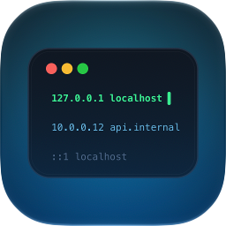
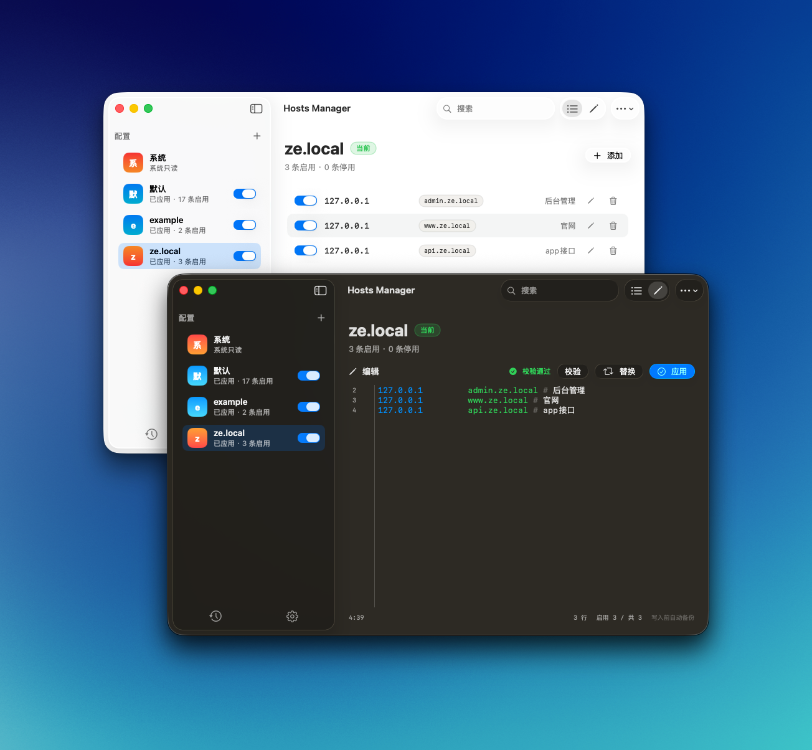

<p align="center">

</p>

<h1 align="center">Hosts Manager</h1>

<p align="center">Hosts Manager is the <b>modern</b> hosts file manager for macOS.</p>

Manage `/etc/hosts` with profiles: structured list editing, source editing, real-time apply, automatic backups, and a signed background writer helper.

## Screenshot

<p align="center">

</p>

## Features

- Profile-based hosts management with one-click switching
- Combinable management: enable multiple profiles and merge them into one write
- Import and export profiles
- Native Swift (SwiftUI + Swift)
- Structured list editing and raw `/etc/hosts` source editing
- Conflict and duplicate detection before writes
- Real-time apply when enabled profiles change
- Automatic timestamped backups with restore
- Optional silent writes through a privileged LaunchDaemon helper
- Chinese and English interface
- No telemetry, no network access, no third-party analytics

## Requirements

- macOS 26 or newer
- Xcode 26.6 or newer to build

## Installation

Download the DMG matching your Mac from the [Releases](https://github.com/breeze-ev/hosts-manager/releases) page:

| File | Mac |
| --- | --- |
| `Hosts-Manager-*-arm64.dmg` | Apple Silicon (M-series) |
| `Hosts-Manager-*-x86_64.dmg` | Intel |

Not sure which one? Open the Apple menu → About This Mac: "Chip" shows an Apple M-series for arm64, or Intel for x86_64.

To install:

1. Open the downloaded DMG.
2. Drag **Hosts Manager** into the **Applications** folder.
3. Launch Hosts Manager from Applications.

## Build from Source

```bash
git clone https://github.com/breeze-ev/hosts-manager.git
cd hosts-manager
open hosts-manager.xcodeproj
```

Select your own development team in the Signing & Capabilities pane for both the `hosts-manager` and `HostsManagerHelper` targets. The app and helper must be signed by the same team so the helper can verify the caller.

You can also build from the command line:

```bash
xcodebuild build \
  -project hosts-manager.xcodeproj \
  -scheme hosts-manager \
  -destination 'platform=macOS' \
  -derivedDataPath build
```

## Using the App

On first launch, Hosts Manager creates a read-only System profile and an editable default profile. Enable the background writer helper in Settings to write `/etc/hosts` silently. The app backs up the current file before every write and stores backups in Application Support.

For a source-only build, the helper may not install unless both the app and helper are properly signed with your own team.

## Release Packaging

`scripts/build-dmg.sh` archives, signs, and builds two separate DMGs (arm64 and x86_64). Version, build number, and Team ID are read from the Xcode project automatically:

```bash
./scripts/build-dmg.sh           # Developer ID signed + notarized (requires a paid developer certificate)
./scripts/build-dmg.sh --dev     # Apple Development signed, no notarization; recommended for local personal use
./scripts/build-dmg.sh --adhoc   # ad-hoc signed, no notarization, no certificate needed (note: the background helper won't work, see below)
```

> **Signing matters**: the background writer helper is registered via SMAppService, and macOS ties Login Items approval to the code-signing identity. Ad-hoc builds have no stable identity, so the toggle can be switched on but the daemon never actually registers, and the app keeps reporting "background helper unavailable". Use `--dev` for local builds (a free Apple Development certificate is enough) and Developer ID for release.

Notarization requires the `APPLE_API_KEY_ID`, `APPLE_API_ISSUER_ID`, and `APPLE_API_KEY_PATH` environment variables; use `--skip-notarize` to skip it only. Artifacts are written to `dist/` with sha256 checksum files.

## Documentation

- [中文说明](README.md)
- [Changelog](CHANGELOG.en.md)
- [Contributing](CONTRIBUTING.md)
- [Security](SECURITY.md)
- [Privacy](PRIVACY.md)

## License

Hosts Manager is released under the [MIT License](LICENSE).
